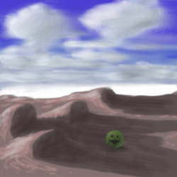
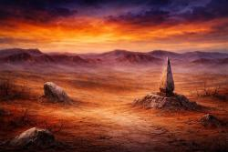

# OpenGameArt: music

**36 assets from [OpenGameArt](https://opengameart.org), dedicated to the public domain under [CC0](https://creativecommons.org/publicdomain/zero/1.0/).** Use them in any game, free or paid, and change them however you like; no credit is needed.

Music from OpenGameArt entries licensed CC0 (some also offer other licences; CC0 is the one that applies here). 892.0 MB in all.

This is a copy kept by [zuujis-cc0](https://github.com/zuujis-cc0) so game makers can take single files from GitHub. It is not made by or affiliated with OpenGameArt: the originals, often in more formats and higher resolutions, are on [opengameart.org](https://opengameart.org). If they help you, consider [supporting OpenGameArt](https://opengameart.org/content/faq).

Every file is listed in [MANIFEST.tsv](MANIFEST.tsv) with its size and SHA-256. More free assets: [the Zuujis collection](https://github.com/zuujis-cc0/free-game-assets#readme).

| | | | |
| :-: | :-: | :-: | :-: |
| <b><a href="00-on-a-prayer-title">00 On a Prayer Title</a></b> by Eltonthomasmba · <a href="https://opengameart.org/content/00-on-a-prayer-title">source</a> | <b><a href="02-on-a-prayer-chapter-2-vanished-without-a-trace">02 On a Prayer Chapter 2 Vanished without a Trace</a></b> by Eltonthomasmba · <a href="https://opengameart.org/content/02-on-a-prayer-chapter-2-vanished-without-a-trace">source</a> | <b><a href="03-on-a-prayer-music">03 On a Prayer Music</a></b> by Eltonthomasmba · <a href="https://opengameart.org/content/03-on-a-prayer-music">source</a> | <b><a href="060">060</a></b> by Some Weirdo · <a href="https://opengameart.org/content/060">source</a> |
| <b><a href="10-track-modern-chiptune-demo">10 Track Modern Chiptune Demo</a></b> by IndieDevs · <a href="https://opengameart.org/content/10-track-modern-chiptune-demo">source</a> | <b><a href="16-bit-battle-theme-i">16-bit - Battle Theme I</a></b> by HydroGene · <a href="https://opengameart.org/content/16-bit-battle-theme-i">source</a> | <b><a href="435">4.35</a></b> by sdacfn · <a href="https://opengameart.org/content/435">source</a> | <b><a href="8-bit-synth">8-bit synth</a></b> by GamingFandom · <a href="https://opengameart.org/content/8-bit-synth">source</a> |
| <b><a href="80s-hidden-lab">80s Hidden Lab</a></b> by Centurion_of_war · <a href="https://opengameart.org/content/80s-hidden-lab">source</a> | <b><a href="80s-mysterywave-music">80s Mysterywave music</a></b> by DesertDev · <a href="https://opengameart.org/content/80s-mysterywave-music">source</a> | <b><a href="8bit-action-ending">8bit Action Ending</a></b> by MintoDog · <a href="https://opengameart.org/content/8bit-action-ending">source</a> | <b><a href="8bit-action-final-boss-battle">8bit Action Final Boss Battle</a></b> by MintoDog · <a href="https://opengameart.org/content/8bit-action-final-boss-battle">source</a> |
| <b><a href="8bit-action-stage-select">8bit Action Stage Select</a></b> by MintoDog · <a href="https://opengameart.org/content/8bit-action-stage-select">source</a> | <b><a href="a-choice-with-many-regrets">A Choice With Many Regrets</a></b> by Tsorthan Grove · <a href="https://opengameart.org/content/a-choice-with-many-regrets">source</a> | <b><a href="a-day-in-night-out">A Day In, Night Out</a></b> by Tsorthan Grove · <a href="https://opengameart.org/content/a-day-in-night-out">source</a> | <b><a href="a-detuned-memory">A Detuned Memory</a></b> by Tarush Singhal · <a href="https://opengameart.org/content/a-detuned-memory">source</a> |
| <b><a href="a-dreamy-forest">A Dreamy Forest</a></b> by Sen · <a href="https://opengameart.org/content/a-dreamy-forest">source</a> | <b><a href="a-kingdom-of-tears-battle-themeremake-finished-version">A Kingdom of tears battle theme(REMAKE) (finished version)</a></b> by game guy maker · <a href="https://opengameart.org/content/a-kingdom-of-tears-battle-themeremake-finished-version">source</a> | <b><a href="a-kingdom-of-tears-battle-themeremakewip">A Kingdom of tears battle theme(REMAKE)(wip)</a></b> by game guy maker · <a href="https://opengameart.org/content/a-kingdom-of-tears-battle-themeremakewip">source</a> | <b><a href="a-platformer-theme">A Platformer Theme</a></b> by Lyricsz · <a href="https://opengameart.org/content/a-platformer-theme">source</a> |
| <b><a href="a-respectable-amount-of-bounce">A respectable amount of Bounce</a></b> by Some Weirdo · <a href="https://opengameart.org/content/a-respectable-amount-of-bounce">source</a> | <b><a href="a-slow-day">a slow day</a></b> by haruta · <a href="https://opengameart.org/content/a-slow-day">source</a> | <b><a href="a-slow-day-remixed-haruta-vs-pro-sensory">A slow day remixed (Haruta vs Pro sensory)</a></b> by glitchart · <a href="https://opengameart.org/content/a-slow-day-remixed-haruta-vs-pro-sensory">source</a> | <b><a href="acc2005v2">acc2005_v2</a></b> by oglsdl · <a href="https://opengameart.org/content/acc2005v2">source</a> |
| <b><a href="agree">agree</a></b> by haruta · <a href="https://opengameart.org/content/agree">source</a> |  <b><a href="album-1-0">Album 1</a></b> by Diztor_Zizyow · <a href="https://opengameart.org/content/album-1-0">source</a> | <b><a href="alien-invasion-track">Alien Invasion Track</a></b> by EZduzziteh · <a href="https://opengameart.org/content/alien-invasion-track">source</a> |  <b><a href="alien-world">Alien World</a></b> by Tsorthan Grove · <a href="https://opengameart.org/content/alien-world">source</a> |
| <b><a href="aliens">Aliens</a></b> by oglsdl · <a href="https://opengameart.org/content/aliens">source</a> | <b><a href="all-in-your-head">All in your head</a></b> by Some Weirdo · <a href="https://opengameart.org/content/all-in-your-head">source</a> | <b><a href="amusement-park-stage">Amusement park Stage</a></b> by MintoDog · <a href="https://opengameart.org/content/amusement-park-stage">source</a> | <b><a href="an-untold-legend">An Untold Legend</a></b> by SkyleTheFrench · <a href="https://opengameart.org/content/an-untold-legend">source</a> |
| <b><a href="apple-cider-juiced">Apple Cider Juiced!</a></b> by Zane Little Music · <a href="https://opengameart.org/content/apple-cider-juiced">source</a> | <b><a href="aprils-finale">April's Finale</a></b> by Pro Sensory · <a href="https://opengameart.org/content/aprils-finale">source</a> | <b><a href="aprils-finale-v2-loop-electronic">April's Finale v2 (loop) Electronic</a></b> by Pro Sensory · <a href="https://opengameart.org/content/aprils-finale-v2-loop-electronic">source</a> | <b><a href="arbitrary">arbitrary</a></b> by sdacfn · <a href="https://opengameart.org/content/arbitrary">source</a> |

---

Kept up to date by this repository's own [update workflow](.github/workflows/update.yml), with code and plan from [cc0-mirror](https://github.com/zuujis-cc0/cc0-mirror). Something wrong? [Open an issue there](https://github.com/zuujis-cc0/cc0-mirror/issues/new) or use the [private report form](https://games.zuujis.com/report).
